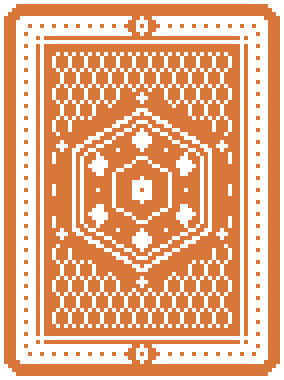
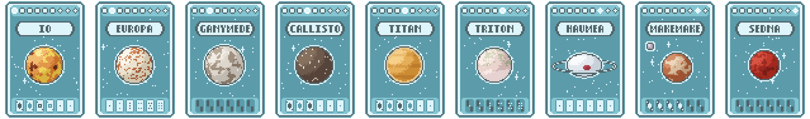

# Sixfold Deck

A [Balatro](https://www.playbalatro.com/) mod that adds the **Sixfold Deck**: a standard 52-card deck that lets you play and discard **up to 6 cards** at once, with nine new 6-card poker hands to chase.

<p align="center"></p>

## The deck

> Play and discard up to **6** cards.
> Each **6-card hand** played gives **X0.1** Mult to 6-card hands and **$2** at end of round.
> **−1** hand every round.

- **Growing X-Mult:** every new 6-card hand you play permanently adds X0.1 Mult to 6-card hands for the rest of the run. A badge above your draw pile shows the current value.
- **Cash-out bonus:** each new 6-card hand played during a round pays $2 when you cash out, shown as its own line on the cash-out screen.
- **Stricter Straight Flush:** in Sixfold runs, a Straight Flush must be made from the same five cards. With six cards, vanilla would otherwise count any hand that holds a straight *and* a separate flush.

## New poker hands

Ranked among the vanilla hands, weakest to strongest:

| Hand | Made of | Base | Slots in above |
|---|---|---|---|
| Three Pair | 3 pairs of different ranks | 35 × 4 | Flush |
| Long Straight | 6 cards in a row | 50 × 5 | Full House |
| Big Flush | 6 cards of one suit | 55 × 5 | Long Straight |
| Double Trips | 2 three-of-a-kinds of different ranks | 70 × 7 | Four of a Kind |
| Mansion | Four of a Kind + a Pair | 80 × 8 | Double Trips |
| Long Straight Flush | 6 in a row, one suit | 120 × 10 | Straight Flush |
| *Six of a Kind* | 6 of one rank | 180 × 18 | Flush Five |
| *Flush Mansion* | Mansion, all one suit | 200 × 20 | Six of a Kind |
| *Flush Six* | 6 of one rank and suit | 220 × 22 | Flush Mansion |

Hands in *italics* are secret: they stay hidden until played, like Five of a Kind, and need duplicated cards. Shortcut allows gaps in the 6-card straights; Four Fingers does not shorten the 6-card hands.

The new hands and their planets only appear in Sixfold runs. Other decks play exactly as vanilla.

## Planet cards

Each new hand has its own planet: moons for the regular hands, dwarf planets for the secret ones.



Io (Three Pair) · Europa (Long Straight) · Ganymede (Big Flush) · Callisto (Double Trips) · Titan (Mansion) · Triton (Long Straight Flush) · Haumea (Six of a Kind) · Makemake (Flush Mansion) · Sedna (Flush Six)

## Joker changes (Sixfold runs only)

| Joker | Change |
|---|---|
| Superposition | A Long Straight with an Ace creates **2** Tarot cards |
| Seance | A Long Straight Flush creates **2** Spectral cards (with a little ceremony) |
| Runner | A Long Straight gains **+30** Chips |
| Spare Trousers | Three Pair gains **+4** Mult |
| Faceless Joker | Discarding **6** face cards at once earns **$12** |
| To Do List | Pays **double** when the target is a 6-card hand |

Each changed joker shows an extra tooltip explaining its change during Sixfold runs.

## Installation

1. Install [Steamodded](https://github.com/Steamodded/smods) (and Lovely, which it needs).
2. Download `SixfoldDeck.zip` from the [latest release](https://github.com/BShadid/BalatroSixfoldDeck/releases/latest).
3. Unzip it into your Mods folder, so you end up with `Mods/SixfoldDeck/`:
   - Windows: `%AppData%/Balatro/Mods`
   - macOS: `~/Library/Application Support/Balatro/Mods`
4. Start Balatro and pick the Sixfold Deck.

### Requirements

- Steamodded **26.1002.0** (tested). Older versions back to **1.0.0~BETA-0509c** are also supported.
- Lovely **0.9.0** or newer (required by current Steamodded)
- The latest Steam version of Balatro

## Development

The mod is a single `main.lua` plus assets:

| Path | Contents |
|---|---|
| `main.lua` | Deck, hands, planets, joker changes, UI |
| `localization/en-us.lua` | Joker tooltip text |
| `assets/1x`, `assets/2x` | Card back and planet art (normal and double resolution) |
| `assets/sounds` | Seance sound effects |
| `art_src/` | Scripts that generate the art (Python 3 with Pillow and NumPy) |

To regenerate art, run a script with an output folder, then copy the results into `assets/`:

```
python art_src/make_planets.py out    # planets_1x.png, planets_2x.png
python art_src/make_back.py out       # back_1x.png, back_2x.png
```

### Releasing

1. Update `version` in `SixfoldDeck.json` and add a matching section to `CHANGELOG.md`.
2. Commit, then tag and push: `git tag v1.0.0 && git push origin v1.0.0`.
3. The release workflow checks the tag matches the mod's version, builds `SixfoldDeck.zip`, and publishes a GitHub release with that version's changelog notes.

## License

[MIT](LICENSE). All art and sounds in this repository are original and covered by the same license. Balatro is © LocalThunk and is not included.
